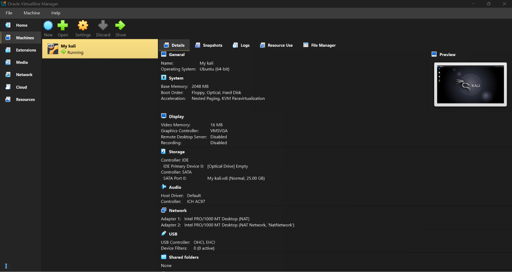

# Cybersecurity-Lab-Setup
Step-by-step documentation for setting up an isolated virtual cybersecurity lab using VirtualBox and Kali Linux, featuring a custom 10.0.0.0/24 NAT network configuration.
# 
 🛡️ Cybersecurity Lab Environment Setup 

Step-by-step documentation for setting up an isolated virtual cybersecurity lab using VirtualBox and Kali Linux, featuring a custom 10.0.0.0/24 NAT network configuration.

  
  
  
  
  

---

## 🚀 Project Overview

This project documents the setup of an isolated virtual cybersecurity laboratory using Oracle VM VirtualBox and Kali Linux. 

The lab provides a controlled environment for practicing cybersecurity concepts, network reconnaissance, vulnerability assessment, and penetration-testing techniques in a safe and authorized environment.

---

## 🎯 Objectives

* Install and configure Oracle VM VirtualBox and Kali Linux.
* Build an isolated virtual cybersecurity laboratory.
* Configure a custom NAT Network for the virtual lab.
* Configure appropriate IP addressing, gateway, and DNS settings.

---

## 💻 Lab Environment

| Component | Configuration |
| :--- | :--- |
| **Host Operating System** | Windows 11 |
| **Virtualization Platform** | Oracle VM VirtualBox |
| **Security Operating System** | Kali Linux |
| **Network Mode** | NAT Network |
| **Kali Linux IP** | `10.0.0.2/24` |
| **Default Gateway** | `10.0.0.1` |

---

## 📐 Lab Architecture

---

## 🛠️ Installation & Setup

### 1. Install VirtualBox
Oracle VM VirtualBox was installed on the host to provide the virtualization environment.

### 2. Configure the NAT Network
A dedicated NAT Network was created in VirtualBox with the following configuration:

| Network Component | Configuration |
| :--- | :--- |
| **Name** | `NatNetwork` |
| **IPv4** | `10.0.0.0/24` |
| **DHCP** | Enabled |
